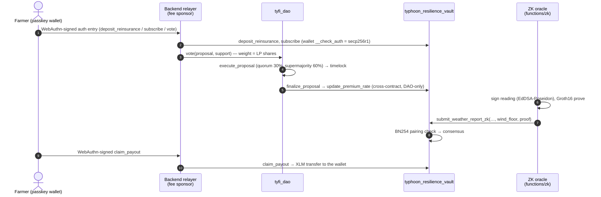

# TyFi — Integration Guide

How the pieces connect, and the exact payloads to call them with. Everything
here is on Stellar Testnet; contract addresses are in
[`REPLICATION_GUIDE.md`](REPLICATION_GUIDE.md#2-read-only-verification-of-the-tyfi-deployment).



---

## 1. ZK weather reports

### 1.1 The statement

The oracle proves: *my registered EdDSA key signed `(typhoon, region, wind,
damage)`, and `wind ≥ wind_floor`*. `wind` stays private; `wind_floor` is the
highest payout band (100 / 120 / 150 km/h) it clears. Full constraint list:
[`circuits/weather_threshold/README.md`](../circuits/weather_threshold/README.md).

### 1.2 Contract entrypoint

```rust
// contracts/typhoon_resilience_vault/src/lib.rs
pub fn submit_weather_report_zk(
    env: Env,
    oracle: Address,          // must be set_oracle(active) and have a registered key hash
    typhoon_id: Symbol,
    region: Symbol,
    damage_percentage: u32,   // 0..=100
    wind_floor: u32,          // the band the proof attests to; stored as OracleWindSpeed
    proof: Groth16Proof,      // { a: BytesN<64>, b: BytesN<128>, c: BytesN<64> }
) -> Result<(), Error>
```

The vault rebuilds all five public inputs itself:
`[OracleZkKeyHash(oracle), symbol_to_field(typhoon_id), symbol_to_field(region), wind_floor, damage_percentage]`.
It then checks `e(-A,B)·e(α,β)·e(vk_x,γ)·e(C,δ) == 1` with `env.crypto().bn254()`
and emits `("zk_report_verified", typhoon_id, region) → (oracle, wind_floor, damage)`.

| Error | Code | Meaning |
|---|---|---|
| `ZkNotConfigured` | 16 | no verifying key, or no key hash for this oracle |
| `InvalidProof` | 17 | the pairing check failed for the rebuilt inputs |
| `Unauthorized` | 3 | the oracle is not active |
| `AlreadyInitialized` | 1 | consensus for this (typhoon, region) already exists |

### 1.3 Encodings

Point encoding is Soroban's Ethereum-compatible format (big-endian; G2 is
`x.c1 ‖ x.c0 ‖ y.c1 ‖ y.c0`, the order snarkjs uses for Solidity calldata).

```ts
// functions/zk/encoding.ts
export function symbolToField(symbol: string): bigint {
  const digest = crypto.createHash('sha256').update(xdr.ScVal.scvSymbol(symbol).toXDR()).digest();
  digest[0] = 0; // always below the BN254 scalar modulus
  return BigInt('0x' + digest.toString('hex'));
}
export const g1Bytes = (p) => Buffer.concat([fp(p[0]), fp(p[1])]);                       // 64 bytes
export const g2Bytes = (p) => Buffer.concat([fp(p[0][1]), fp(p[0][0]), fp(p[1][1]), fp(p[1][0])]); // 128 bytes
```

```rust
// contracts/typhoon_resilience_vault/src/lib.rs — must match the TS above
pub fn symbol_to_field(env: &Env, symbol: &Symbol) -> U256 {
    let mut digest = env.crypto().sha256(&symbol.clone().to_xdr(env)).to_array();
    digest[0] = 0;
    U256::from_be_bytes(env, &Bytes::from_array(env, &digest))
}
```

Region and typhoon symbols follow the frontend's `sanitizeSymbol`: every
character outside `[A-Za-z0-9_]` becomes `_`, truncated to 32. The oracle uses
the same rule (`functions/zk/request.ts`), so `"Eastern Visayas"` →
`Eastern_Visayas` on both the policy and the report.

### 1.4 Proving and submitting from TypeScript

```ts
import { Keypair } from '@stellar/stellar-sdk';
import { loadOracleZkKey, proveWeatherReading } from './functions/zk/prover';
import { submitZkReport } from './functions/zk/submit';

const key = await loadOracleZkKey(process.env.ORACLE_ZK_PRIVATE_KEY);
const { proof, publicSignals, provingMs } = await proveWeatherReading(
  { typhoonId: 'ODETTE_2026', region: 'Eastern_Visayas', windSpeed: 172, windFloor: 150, damagePercentage: 85 },
  key,
);
const { txHash, ledger } = await submitZkReport(
  { typhoonId: 'ODETTE_2026', region: 'Eastern_Visayas', windFloor: 150, damagePercentage: 85, proof },
  {
    rpcUrl: 'https://soroban-testnet.stellar.org',
    passphrase: 'Test SDF Network ; September 2015',
    vaultContractId: 'CARODUWJWUBI5UPKQCAVGT7GXKJN65ZDVEOPSYCWPBGC6F5MYQJXCQZR',
    oracle: Keypair.fromSecret(process.env.ORACLE_SECRET_KEY!),
  },
);
```

`proofToScVal` encodes `Groth16Proof` as an `ScMap` with symbol keys in sorted
order (`a`, `b`, `c`) and `ScBytes` values.

### 1.5 The same call from the CLI

```bash
stellar contract invoke --id $VAULT --source tyfi_zk_oracle --network testnet --send=yes -- \
  submit_weather_report_zk \
  --oracle $(stellar keys address tyfi_zk_oracle) \
  --typhoon_id ODETTE_2026 --region Eastern_Visayas \
  --damage_percentage 85 --wind_floor 150 \
  --proof '{"a":"<128 hex>","b":"<256 hex>","c":"<128 hex>"}'
```

### 1.6 Oracle REST API

`POST /oracle/api/v1/weather-trigger` (testnet only; the backend holds the
oracle keys):

```json
{ "typhoonId": "E2E_CHECK_1", "region": "Week4_Test", "windSpeed": 163, "damagePercentage": 70, "network": "testnet" }
```

Optional `"proofSystem"`: `"groth16"` (default) or `"noir"` (§1.8). The
response's `zk.proofSystem` is `groth16-circom` or `ultrahonk-noir`.

Response from a live testnet run
([tx `eeae878f…`](https://stellar.expert/explorer/testnet/tx/eeae878fe0d4bd90b679078e75c740273d29fcce80b7db5187af020d259c82c3)):

```json
{
  "status": "success",
  "txHash": "eeae878fe0d4bd90b679078e75c740273d29fcce80b7db5187af020d259c82c3",
  "typhoonId": "E2E_CHECK_1",
  "region": "Week4_Test",
  "windFloor": 150,
  "damagePercentage": 70,
  "zk": {
    "proof": "25d7fad3…97bab28a",
    "publicSignals": [
      "16903983959979666084249553466291075550611473209871867804533960125777664860862",
      "174033536779462894065926558031608875918726151974018840976343555625329539300",
      "148027531333361528968251800669357749975095505635557353898207591744382510101",
      "150",
      "70"
    ],
    "provingMs": 1367,
    "cpuInstructions": 30430827,
    "ledger": 5348327
  }
}
```

| Status | When |
|---|---|
| 400 | invalid typhoon/region symbol, wind not an integer in 0–500, damage not 1–100, wind below 100 km/h, or an unknown `proofSystem` |
| 403 | `network` is not `testnet` |
| 422 | the vault rejected the proof (`InvalidProof`) |
| 502 | proving or submission failed (e.g. consensus already reached for that typhoon/region) |
| 503 | `ORACLE_SECRET_KEY` is not configured |

### 1.7 Admin setup

All three are admin-multisig calls. Signers sign
`sha256(admin_nonce as u64 BE ‖ fn_name)`, and each call consumes the nonce.

```bash
set_zk_verifying_key --signatures '[["<pubkey hex>","<sig hex>"]]' \
  --vk '{"alpha":"…","beta":"…","gamma":"…","delta":"…","ic":["…","…","…","…","…","…"]}'
set_oracle         --signatures … --oracle G… --is_active true
set_oracle_zk_key  --signatures … --oracle G… --key_hash <decimal Poseidon(Ax, Ay)>
```

[`scripts/week4/zk_testnet_rollout.mjs`](../scripts/week4/zk_testnet_rollout.mjs)
builds the signatures (`adminSigs` in [`lib.mjs`](../scripts/week4/lib.mjs)) and
the VK JSON from `functions/zk/artifacts/verification_key.json`.

### 1.8 The Noir path (UltraHonk, verified on-chain)

The same statement, proven with the Noir circuit
([`circuits/weather_threshold_noir`](../circuits/weather_threshold_noir)) and
checked by the vault through [`contracts/noir_verifier`](../contracts/noir_verifier):

```rust
pub fn submit_weather_report_noir(
    env: Env,
    oracle: Address,
    typhoon_id: Symbol,
    region: Symbol,
    damage_percentage: u32,
    wind_floor: u32,
    proof: Bytes,             // 14,592-byte UltraHonk proof (bb 0.87.0, Keccak transcript)
) -> Result<(), Error>

pub fn set_noir_verifier(env: Env, signatures: Vec<(BytesN<32>, BytesN<64>)>, verifier: Address) -> Result<(), Error>
pub fn get_noir_verifier(env: Env) -> Option<Address>
```

The vault concatenates the same five public inputs as 32-byte big-endian
values (`key hash ‖ typhoon ‖ region ‖ wind_floor ‖ damage`, 160 bytes) and
calls `verify_proof(public_inputs, proof)` on the verifier set by
`set_noir_verifier`. A failed verification is `InvalidProof` (#17); no
verifier or oracle key hash is `ZkNotConfigured` (#16). It emits
`("noir_report_verified", typhoon_id, region) → (oracle, wind_floor, damage)`.

```ts
import { proveWeatherReadingNoir } from './functions/zk/noirProver';
import { submitNoirReport } from './functions/zk/submit';

const { proof } = await proveWeatherReadingNoir(reading, key);   // @aztec/bb.js 0.87.0, { keccak: true }
const { txHash } = await submitNoirReport({ typhoonId, region, windFloor, damagePercentage, proof }, submitConfig);
```

Testnet run: [`6fe00c6d…`](https://stellar.expert/explorer/testnet/tx/6fe00c6dbd575d190e7fca544e9846adfca2280a6b1ba405f4391c44f818736b)
(87.4M CPU instructions; the per-transaction limit is 400M). The verifier
supports Barretenberg's non-zero-knowledge flavor, so a Noir proof does not
hide the wind reading; the Groth16 path does. Proving peaks at about 520 MB in
the oracle process.

---

## 2. DAO → vault parameter updates

```rust
// contracts/tyfi_dao/src/lib.rs
create_proposal(creator, description, action_type, param_value, param_region, param_oracle, param_oracle_active, duration_ledgers) -> u64
vote(voter, proposal_id, support)                // weight = vault LP shares of `voter`
execute_proposal(proposal_id) -> ProposalStatus  // after the deadline: quorum + threshold
finalize_proposal(caller, proposal_id)           // Executor/Admin, after the timelock
```

| `action_type` | `param_value` | Who may propose | Threshold | Vault call made by `finalize_proposal` |
|---|---|---|---|---|
| `UpdatePremiumRate` | multiplier 1–1000 (+ `param_region`) | Proposer role or ≥ 1,000 LP shares | 60% | `update_premium_rate(region, multiplier)` |
| `UpdateQuorumThreshold` | 1–100 | Proposer role or LP shares | 60% | `dao_update_quorum_threshold` |
| `UpdateSolvencyCap` | bps 100–9500 | Admin | 60% | `dao_update_solvency_cap` |
| `RegisterOracle` | `param_oracle`, `param_oracle_active` | Admin | 50.01% | `dao_set_oracle` |

Quorum is 30% of the vault's total LP shares at proposal creation. The timelock
is 8,640 ledgers after the deadline (~12 h at 5 s per ledger). The vault accepts
these `dao_*` calls only from the address stored by `set_dao_address`.

CLI (enum variants are passed by name):

```bash
stellar contract invoke --id $DAO --source freighter_wallet --network testnet --send=yes -- create_proposal \
  --creator $(stellar keys address freighter_wallet) \
  --description "Raise the Eastern_Visayas premium multiplier to 125" \
  --action_type UpdatePremiumRate --param_value 125 --param_region Eastern_Visayas \
  --param_oracle $(stellar keys address freighter_wallet) --param_oracle_active 0 \
  --duration_ledgers 180
```

TypeScript (the app's helpers in `frontend/src/lib/stellar.ts`; they route
through the passkey relayer when the connected wallet is a passkey wallet):

```ts
const proposalTx = await createDaoProposal(wallet, description,
  { actionType: 'UpdatePremiumRate', region: 'Eastern Visayas', value: 125 }, 180, 'testnet');
const voteTx = await voteOnDaoProposal(6, true, 'testnet', wallet);
```

---

## 3. Passkey wallets

A passkey wallet is a `smart_wallet` contract deployed by
`smart_wallet_factory` from a WebAuthn credential. Its `__check_auth` verifies
the secp256r1 signature over the Soroban auth payload. The backend relayer only
pays fees: it is the transaction source and is never an authorizer, and it
only forwards calls to the vault, the DAO and the XLM SAC
(`PASSKEY_ALLOWED_CONTRACTS`). Design and threat model:
[`passkey-architecture.md`](passkey-architecture.md).

In the app, any `executeTrackedTx` call made while a passkey session is
connected goes through `invokeWithPasskey`. No call-site changes are needed:

```ts
await contributeLiquidityOnChain(wallet, 1500, 'lp', 'deposit', 'testnet'); // deposit_reinsurance
await registerPolicyOnChain(wallet, 'TYFI_COOP_FARM_01', 'Eastern Visayas', 200_000_000, 'Wet Season 2026', 'testnet');
await claimPayoutOnChain(wallet, 'TYFI_COOP_FARM_01', 'Wet Season 2026', 'testnet', 'ODETTE_2026');
```

The relayer refuses transactions whose prepared fee exceeds
`PASSKEY_MAX_FEE_STROOPS` (default 1 XLM).

---

## 4. Payout

```rust
claim_payout(farmer, farm_id, season, typhoon_id) -> i128   // stroops paid
```

The vault pays `policy.payout_amount × pct / 100`. `pct` is the consensus
damage for `(typhoon_id, policy.region)`, or, if the region has
`ParametricBands`, the highest band whose `min_wind_speed ≤` the proven wind
floor. A policy pays once. The frontend reads the paid amount from the
transaction's return value (`getClaimedPayoutStroops` in
`frontend/src/lib/zkOracle.ts`).
